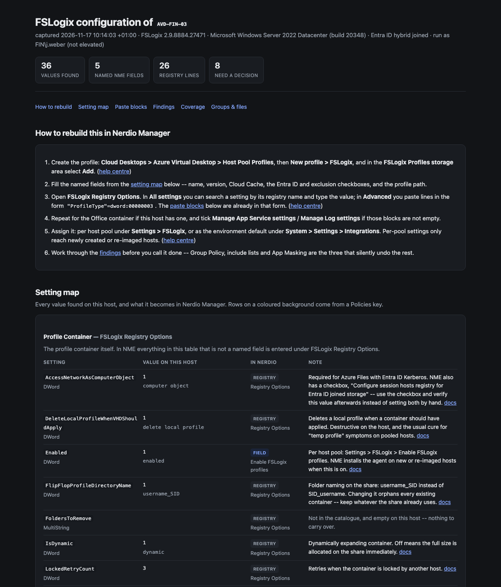

# fslogix-to-nerdio

Reads the FSLogix configuration of a Windows session host and writes **one self-contained
HTML file** that says, setting by setting, where it goes in **Nerdio Manager for Enterprise**
— plus paste-ready blocks for NME's *Advanced* registry editor and the findings that decide
whether the rebuilt configuration will actually hold.

Built for PoCs: the customer's existing FSLogix setup has to be reproduced in Nerdio Manager,
usually from a host nobody fully documented.

> A personal project, not a Nerdio product — see [Disclaimer](#disclaimer).



*The report from [`samples/sample-capture.json`](samples/sample-capture.json) — open
[`samples/sample-report.html`](samples/sample-report.html) in a browser for the whole thing,
including the paste blocks and the findings.*

```powershell
powershell -ExecutionPolicy Bypass -File .\Export-FSLogixConfig.ps1
```

One file to copy to the host, one HTML file out. No modules, no internet, nothing installed,
nothing changed.

## Why it is more than a registry dump

Nerdio Manager's FSLogix profile is, at its core, a registry editor with a handful of named
fields in front of it. Its **Advanced** edit mode takes lines in exactly the form
`"ProfileType"=dword:00000003`, and its **All settings** mode lets you search a setting by its
registry name. So the report can do three things a dump cannot:

1. **Name the field.** Values NME has a real control for — profile path, Cloud Cache, the
   Entra ID and exclusion checkboxes, the Office container, Redirections — are listed with
   that control's name, and deliberately kept *out* of the paste blocks so nothing is set
   twice from two places.
2. **Hand over the rest ready to paste.** Everything else becomes a block in the documented
   Advanced syntax, split per NME editor (Profile Container, Office Container, App Services,
   Logging).
3. **Name what will break.** Group Policy, include-list membership, App Masking rules and
   unreachable paths are the four that quietly undo a rebuilt profile. They get their own
   findings section instead of a footnote.
4. **Say what it could not read.** Every collector records whether it read its source, found
   nothing, or was refused, and the report has a Coverage section for it. On a session host
   the script normally runs as an ordinary user, and a report that cannot tell *absent* from
   *not allowed to look* is worse than no report — it is a confident one.

## What it reads

| Source | Why |
|---|---|
| `HKLM\SOFTWARE\FSLogix\{Profiles,ODFC,Apps,Logging}` | the configuration itself |
| `HKLM\SOFTWARE\Policies\FSLogix\…` | the same names set by policy, listed separately |
| `%WINDIR%\System32\GroupPolicy\**\registry.pol` | scanned for the string `FSLogix` — see below |
| `frxsvc.exe` version, FSLogix services | which agent version to pick in NME |
| `FSLogix Profile/ODFC Include` and `Exclude List` groups | who the containers actually apply to |
| `redirections.xml` (via `RedirXMLSourceFolder`) | the content for NME's Redirections toggle |
| `%ProgramFiles%\FSLogix\Apps\Rules` | App Masking rule files — NME does not carry these |
| `dsregcmd /status` | domain / Entra ID / hybrid, for the Entra ID storage checkbox |
| who the script runs as, and whether elevated | so the Coverage section can be read honestly |

**The Group Policy point is the one worth knowing.** FSLogix's own ADMX writes into the same
registry keys the product uses, so a GPO-set value is indistinguishable from a locally set one
— and it comes back after every policy refresh, overwriting whatever Nerdio Manager wrote. The
script therefore reports two independent signals: a `Policies\FSLogix` key if one exists, and
whether the host's policy files mention FSLogix at all. Neither is proof on its own; together
they tell you where to look. Nerdio's own documentation is blunt about the consequence:
session hosts should not receive conflicting FSLogix configurations from GPOs.

## Options

| | |
|---|---|
| `-OutputPath <file>` | where the HTML goes (default: `.\fslogix-nerdio-<host>-<stamp>.html`) |
| `-SaveJson <file>` | also write the raw capture, to render elsewhere or diff two hosts |
| `-FromJson <file>` | render from such a capture instead of reading the registry — works on any OS |
| `-FromReg <file>[,<file>…]` | render from one or more regedit exports (`.reg`) — for when the customer sends an export instead of running the script; works on any OS, see below |
| `-CatalogPath <file>` | override the annotation catalogue, see [docs/catalog.md](docs/catalog.md) |
| `-TestPaths` | probe the profile and Office container shares (see below) |
| `-IncludeGpResult` | add the applied GPO list from `gpresult /scope computer /r` — computer-scope policy data normally needs an **elevated** run; when it is refused, the report says so instead of leaving the section out |
| `-NoLaunch` | do not open the report when it is done |

**What `-TestPaths` actually probes.** A profile path usually ends in an FSLogix variable
(`\\server\share\%username%`), and nothing expands that outside a sign-in — so the literal
string names a folder that cannot exist. The path is cut before the first `%` and the
**share** is probed instead, which is the part a report can say anything useful about. Each
UNC host is asked on TCP 445 first with a 3-second timeout, and the `Test-Path` behind it is
capped at 15 seconds: an unreachable share used to make this switch look like a hang, because
SMB retries for minutes before giving up.

**What a capture contains.** The host name, the shares, the FSLogix settings, the members of
the four local groups and who ran the script — a configuration export, and it travels: to a
colleague, into a ticket, out of the customer's tenant. It deliberately does *not* keep the
full `dsregcmd` output, which carries the tenant id, the device id and certificate thumbprint
and the signed-in user's address; only the three join answers the report actually uses are
kept.

Capture on the host, read the report anywhere:

```powershell
.\Export-FSLogixConfig.ps1 -SaveJson .\avd-fin-03.json -TestPaths
```

```bash
pwsh ./Export-FSLogixConfig.ps1 -FromJson ./avd-fin-03.json -OutputPath ./report.html
```

**When the customer sends a registry export instead.** Some customers will not run a script on
a session host but will happily send a `.reg` file. Ask for these two — the second one fails
with "unable to find the specified registry key" when no policy sets FSLogix, which is itself
the answer:

```cmd
reg export "HKLM\SOFTWARE\FSLogix" fslogix.reg
reg export "HKLM\SOFTWARE\Policies\FSLogix" fslogix-policies.reg
```

```bash
pwsh ./Export-FSLogixConfig.ps1 -FromReg ./fslogix.reg,./fslogix-policies.reg -OutputPath ./report.html
```

The settings map and the paste blocks come out the same as from a capture. Everything an export
cannot carry — agent version, services, join state, the include/exclude groups,
`redirections.xml`, App Masking rules, policy files — is marked *skipped* in Coverage and named
in a finding, so the report says *unknown* there, never *absent*. A key counts as absent only
when the export covers its parent key and the key is not in it. The `Sessions` subkeys, which
hold signed-in users' names and container paths, are counted as evidence that FSLogix was
running and otherwise left out of both the report and the capture. Add `-SaveJson` to keep
the result as an ordinary capture.

## What it does not do

- **It does not write to Nerdio Manager.** No API call, no token, no automation — the report
  is for a human rebuilding the profile in the UI. Deliberate: a PoC is the moment to look at
  each setting once, and NME's API surface for FSLogix profiles would need credentials the
  tool has no business holding.
- **It does not configure FSLogix**, on this host or any other. Read-only throughout.
- **It does not carry App Masking rules or include-list membership.** Those are outside what
  an FSLogix profile in NME holds; the report says so where it finds them.
- **It does not judge the configuration.** It says where a setting goes and what will fight
  it, not whether 30 GB is the right container size.

## The catalogue, and why an incomplete one is harmless

Mapping a registry value to an NME control is hand-curated knowledge; the registry side is
mechanical. The catalogue in the script (`Get-BuiltInCatalog`) holds that knowledge as data —
one entry per value, with the NME field, a one-sentence note, the decode for enum values and a
documentation link.

Entries only *annotate* values that were actually found on the host. An entry that matches
nothing is inert, and a value with no entry is still collected, still shown, and still lands in
the paste block with a note to check it. **A missing or outdated catalogue entry therefore
loses nothing** — the worst case is a row with less commentary. That is the property that
makes it safe to keep the catalogue current by hand as NME's UI moves.

It lives in the script so the tool stays a single file to copy onto a locked-down host.
`-CatalogPath` loads a JSON file over it; the format is in [docs/catalog.md](docs/catalog.md).

## Requirements

- Windows PowerShell 5.1 or PowerShell 7+ for collecting (Windows session host).
- Any OS with PowerShell 7+ for rendering a saved capture.
- Local administrator is not required to read the keys, but is typical on a session host.

## Status

v1.2.0, run on two real hosts. `-FromReg` (new in 1.2.0) has been run against one real
customer export, on macOS with PowerShell 7 — not yet on Windows PowerShell 5.1.

| | |
|---|---|
| **An AVD session host** — Windows 11 Enterprise multi-session, FSLogix 3.26, Entra ID hybrid joined, English | as an ordinary **user, not elevated**: registry keys, agent version, services, all four local groups *with their members*, `redirections.xml`, App Masking rule files, join state — everything came back. Administrator rights are not needed. |
| **A bare VM** — Windows 11 Pro, no FSLogix at all, German, workgroup | **elevated**, with `-IncludeGpResult` and `-SaveJson`: reports "this host has no FSLogix configuration" and nothing else, with no warnings and no empty sections. |

Those two runs produced most of what is in 1.1.x. The ones worth knowing, because they are
the traps rather than the features:

- **`ConvertTo-Json` on Windows PowerShell 5.1 hung** on an ordinary capture. The capture is
  serialised by this script now, not by the shell.
- **A missing local group read as a refusal** on a German host, because the classifier matched
  an English message. Existence and membership are separate questions now, and "does not
  exist" is recognised by error id and number, not by text.
- **`gpresult /scope computer` needs elevation.** It used to fail into silence, which reads
  like "no GPOs apply".
- **`-TestPaths` probed `%username%` literally**, so a perfectly good share came back
  unreachable.

The rendering path is exercised against `samples/sample-capture.json`, which carries the
awkward cases on purpose: a Policies key contradicting the product key, a `QWord` the Advanced
editor cannot express, a value outside the catalogue, an empty multi-string, a multi-string
path list, an unreachable share, App Masking rules, a narrowed include list, an `Everyone`
include list and a refused collector. The import path has its own pair,
`samples/sample-export.reg` and `samples/sample-export-policies.reg`, written the way regedit
writes them (UTF-16 with BOM, wrapped hex lines): multi-string, `QWord` and `ExpandString`
values, escaped quotes, a live `Sessions` subkey, a key deletion, a parent key that makes a
missing key count as absent, and a policy value contradicting the product key.

**One limit worth knowing:** the Group Policy file scan only sees *local* Group Policy. A
domain GPO or an Intune policy writes straight into the registry and leaves no file on the
host, so silence there is not evidence of absence — the `Policies\FSLogix` key is the signal
that carries, and the report says so where it applies.

## Documentation

Field names and navigation paths come from the Nerdio help centre:
[FSLogix settings and configuration](https://nmehelp.getnerdio.com/hc/en-us/articles/25499417371661-FSLogix-settings-and-configuration)
· [FSLogix per-host pool customization](https://nmehelp.getnerdio.com/hc/en-us/articles/26124330262925-FSLogix-per-host-pool-customization)
· [FSLogix and User Profile Management](https://nmehelp.getnerdio.com/hc/en-us/articles/26126637566477-FSLogix-and-User-Profile-Management).
Verify them against your own NME version; the UI moves.

## Contributing

**To be told when a new version is cut**, use *Watch → Custom → Releases* on this repository.
Each release carries the script as a downloadable asset, which is also the transfer that does
not truncate.

Issues and pull requests are welcome, and two kinds are especially useful:

- **Catalogue entries** for settings the report currently carries without a note. Each one is a
  few lines of data in `Get-BuiltInCatalog` — the NME control or editor it belongs to, one
  sentence of what it decides, the enum values where it has them. See
  [docs/catalog.md](docs/catalog.md).
- **Corrections when the Nerdio Manager UI moves** — a renamed field, a changed navigation
  path. Those age silently and are the part a single author cannot keep current alone.

Run the report against `samples/sample-capture.json` before and after a change; it carries the
awkward cases on purpose, so a diff of the two reports shows what you actually moved.

## Disclaimer

**This is a personal project.** It is not a Nerdio product, it is not supported by Nerdio, and
it is not endorsed by Nerdio or Microsoft. The author works at Nerdio as a sales engineer and
wrote and published this in a private capacity; nothing here represents Nerdio's position,
roadmap, documentation or support commitments.

**It reads; it does not change anything.** The script touches no setting on the host it runs
on, and it never talks to Nerdio Manager — the report is something a human works from. What
you do with the values it hands you is your decision and your responsibility.

**Field names and navigation paths will drift.** They were taken from the public Nerdio help
centre at the time of writing. The product UI moves; verify them against the version in front
of you before acting on them, and treat a surprising instruction as out of date rather than
as a fact.

**You own what you share.** A capture or a report describes a real environment — hosts,
shares, group members. Read *[What a capture contains](#options)* before you attach one to a
ticket or hand it to anyone.

Provided **as is**, without warranty or condition of any kind, express or implied, to the
fullest extent permitted by law.

## Rights

Copyright (c) 2026 Christian T. Drieling. Licensed under the Apache License 2.0 — see
[LICENSE](LICENSE). FSLogix, Nerdio Manager and Nerdio are the trademarks of their respective
owners, used here only to say what this tool works with.
